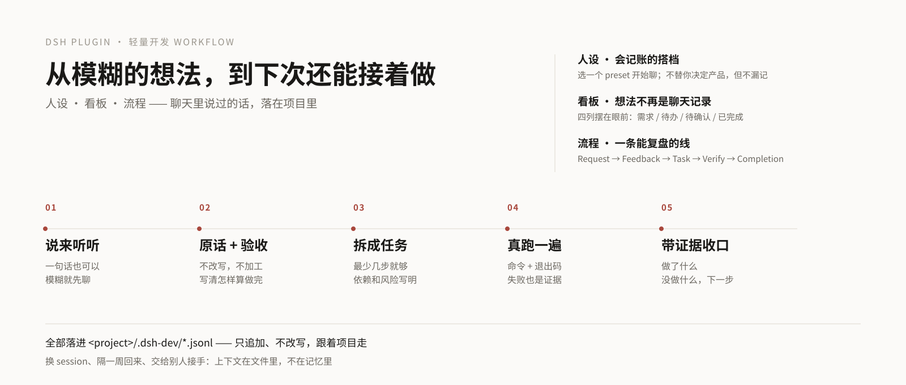

# DSH Dev Workflow

<p align="center">
  
</p>

<p align="center">
  <strong>把研发对话变成可验证、可交接、可复盘的闭环。</strong><br>
  Request → Feedback → Task → Verify → Completion
</p>

<p align="center">
  <a href="https://www.npmjs.com/package/dsh-plugin-dev-workflow"></a>
  <a href="https://github.com/yuna78/dsh-plugin-dev-workflow/actions"></a>
  <a href="LICENSE"></a>
</p>

> 一个面向 DSH 的轻量研发交付助手。它记录决策与证据，但不会把普通聊天自动变成长期记忆。

## 为什么用它？

AI coding 的瓶颈往往不是“不会写”，而是**上下文断裂、决策丢失、验证不可追溯**。

DSH Dev Workflow 把交付过程变成一条可读的证据链：

```text
用户原话 → 可执行任务 → 真实验证 → 带证据的交付总结
     ↘ 反馈与决策 ↗        ↘ 可复盘知识 ↗
```

它不是一个替你执行一切的“自动驾驶按钮”，而是一个让 AI **更像靠谱队友**的工作协议：知道什么时候应该问、什么时候应该等确认、什么时候必须拿证据。

## Preset 的性格

> **冷静、克制、可追责。**

- 不把普通聊天自动变成长久记忆；
- 不把“我应该通过了”当成测试证据；
- 不把反馈悄悄升级为团队规范；
- 不跨项目读取，不自动安装依赖，不自动提交；
- 破坏性动作先停下来，把风险和选择交给人。

它的核心优先级是：**安全边界 > 仓库规范 > 项目目标 > 用户偏好 > 当前请求**。

## 真实环境里为什么有用？

| 真实问题 | 没有闭环时 | 有了 Dev Workflow |
| --- | --- | --- |
| 需求在聊天里变化 | AI 只记住最后一句 | 原话、范围、验收条件可回看 |
| 多轮反馈互相矛盾 | 只能靠上下文猜 | 每条反馈有决策与影响 |
| “已经测过了” | 没有退出码和命令 | 验证记录绑定任务和结果 |
| 换人或隔天继续 | 重新解释项目 | `dev_context_get` 给出有界摘要 |
| 长期知识污染 | 一次偏好变成永久规则 | 只有明确确认才 promote |

## 记录到底长什么样？

插件使用本地 append-only JSONL。下面是**脱敏后的示例**，不是预置数据：

```json
{"schemaVersion":1,"requestId":"req_7f21","rawQuote":"把登录页的错误提示改得更清楚","acceptance":["空密码显示字段级提示","错误提示不泄露账号是否存在"],"status":"captured"}
{"schemaVersion":1,"feedbackId":"fb_12ac","requestId":"req_7f21","rawQuote":"文案要短一些，但保留可操作建议","decision":"accept","category":"quality","status":"recorded"}
{"schemaVersion":1,"taskId":"task_91de","title":"更新登录错误提示","acceptance":["单元测试覆盖两种错误分支"],"status":"queued"}
{"schemaVersion":1,"verificationId":"verify_44aa","taskId":"task_91de","command":"npm test -- login","exitCode":0,"status":"passed"}
{"schemaVersion":1,"completionId":"completion_08c1","taskId":"task_91de","status":"succeeded","verificationRefs":["verify_44aa"]}
```

每个项目默认写入：

```text
<your-project>/.dsh-dev/
├── requests.jsonl
├── feedback.jsonl
├── tasks.jsonl
├── verifications.jsonl
├── completions.jsonl
└── knowledge.jsonl
```

这些记录只保存在本地；请勿写入密钥、客户资料或其他敏感信息，并确保 `.dsh-dev/` 不提交到 Git。

## 安装

### DSH Add plugin

在 DSH 的 **Add plugin** 中搜索：

```text
dsh-plugin-dev-workflow
```

### Plugin manager

```text
plugin_manager install_bundle target=dsh-plugin-dev-workflow
```

### 本地开发

```text
plugin_manager install_bundle target=<本目录绝对路径>
```

安装后新建会话，选择 **研发助手 · Dev Assistant**。不要手写 profile 的 `package.json` 或 `cordis.patch.yml`。

## 工具箱

- `dev_context_get` — 读取项目上下文、未完成任务与最近反馈
- `dev_request_capture` — 保留用户原话并登记验收条件
- `dev_feedback_record` — 记录反馈与决策，不自动升级为长期规范
- `dev_task_plan` — 创建带依赖、风险和验收条件的任务
- `dev_verify` — 记录验证命令与真实退出码
- `dev_complete` — 生成带证据的完成总结
- `dev_knowledge_promote` — 仅在用户明确确认后沉淀知识

## 运行期提醒：让“先登记”真的发生

persona 只是上下文开头的一段话。回合一长，工具结果会把它挤远——我们在真机会话里量到：
`dev_context_get` 在第 1 秒就调用了，但 `dev_request_capture` 拖到 **+86 秒、第 40 次工具调用之后**，
`dev_feedback_record` 整轮没有触发。

所以插件除了 persona 还做一件事：通过 `agent/pre-step` 在**第 1 步以及之后每 5 步**
往请求历史里追加一条提醒，带当前项目的**真实记录计数**：

```text
【研发闭环·运行期提醒】本会话已登记：需求 1 · 任务 2 · 反馈 0 · 验证 0 · 完成 0。
按顺序执行：
1) 用户带来新需求 → 先调用 dev_request_capture（原话 + 验收），再动业务文件；
2) 用户在评价或纠正上一轮结果 → 先调用 dev_feedback_record（保留原话，不加工措辞）；
3) 有可执行工作 → 调用 dev_task_plan 拆最少任务（验收 + 风险 + 依赖）；任务数为 0 时不要先写代码；
4) 每次改动 → 调用 dev_verify 记录真实命令与退出码；收口 → 调用 dev_complete。
只记录真实发生的事：没调用过的工具、没跑过的命令、没被确认过的偏好，一律不得写成记录。
```

开关在 preset 里：`reminder: true`（`reminderEverySteps` 默认 5，设为 `false` 可关闭）。
提醒只读 `<project>/.dsh-dev/`，不写状态、不新增记录；读取失败时原样放行，不会让回合失败。

**怎么确认它在你机器上真的生效**：新会话选「研发助手 · Dev Assistant」，随便说一句需求，
然后查会话日志里有没有这条记录（`kind` 为 `dev-assistant` 的注入消息）：

```bash
zstd -dc ~/.dsh/sessions/*/*/session.v4.jsonl.zstd | grep -c '研发闭环·运行期提醒'
```

## 看板：不用再读 JSON

记录是 append-only JSONL，对机器友好、对人极不友好。0.2.0 起插件带一个 Web 看板：
左侧边栏点「研发看板」，就看到当前工作区的记录。


- **四列**：需求（用户原话 + 验收）、待办（已建任务）、待确认（`waiting-user`）、已完成。
- **三个过滤**：进行中 / 已完成 / 全部，计数与列表同源，不会各算各的。
- **工作区下拉**：看板是全局面板，按 `<工作区>/.dsh-dev/` 读取，切换即换项目。
- **只读**：看板只调一个 GET 路由 `/api/dsh-dev-assistant.board?root=…`；host 侧校验
  `root` 必须是真实目录，并且只打开该目录 `.dsh-dev/` 里那几个已知 JSONL 文件。
  看板不写任何记录；接口失败只显示在页内，不影响会话与 `dev_*` 工具。
- **状态怎么来的**：任务「已完成」= 自身状态 `succeeded/cancelled`，或 `completions.jsonl`
  里有它的收口记录——`dev_complete` 只写 completions，从不改 tasks。

### 记录一多怎么办

一个跑了半年的项目会有几百条需求、上千条任务。看板不假设记录少：

| 维度 | 做法 | 为什么 |
| --- | --- | --- |
| 已完成任务 | host 只返回最新 30 条，列是 `5/150` 这种「已显示/总数」，底部 `显示更多 · 还有 145 条`，点一次 +50 重新取 | 历史是无限增长的轴，必须由服务端截断，否则响应会到几 MB |
| 需求 | 同上，默认 40，`显示更多` 每次 +40 | 需求同样只增不减 |
| 待办 / 待确认 | 每列默认 20，`显示更多` 本地展开 +30，不重新请求 | 这些已经在响应里，本地切片就够，没必要多跑一次 |
| 计数 | 顶部 chips 永远是**全量**（`进行中 350 / 已完成 150 / 全部 500`），列头才显示 `已显示/总数` | 让你知道总量，也知道屏幕上只是一部分 |
| 反馈 | 每个需求 / 任务只挂**最新一条**（按 `createdAt` 取最新），铺反馈历史会把卡片撑爆 | 同 deck-line 的处理：卡片看结论，历史看 `feedback.jsonl` |

实测（合成数据：200 需求 / 300 任务 / 150 完成）：默认响应 **70 KB**，全量 155 KB，
`readBoard()` 约 **10 ms**。响应里的 `window` 字段写明每列 `{shown, total, limit}`，
所以「还有多少」不是前端猜的。

## 兼容性

- DSH：`>=0.2.1-rc.2 <0.3.0`
- Node.js：`>=22.19.0`
- 当前版本：`0.2.0`

## 开发

```bash
node verify/smoke.mjs          # 门禁：工具 + 提醒 + 看板 host/client
node verify/preview.mjs        # 可选：用真实记录离线渲染 docs/preview-board.png
node --check index.js client.js
npm pack --dry-run
```

## 路线图

- [ ] 真实宿主执行器与验证证据绑定
- [ ] 完成任务自动更新状态
- [ ] 路径边界校验与敏感信息检测
- [ ] 干净 profile 安装测试与 CI

## 项目链接

- Repository: https://github.com/yuna78/dsh-plugin-dev-workflow
- Changelog: [CHANGELOG.md](CHANGELOG.md)
- Issues: https://github.com/yuna78/dsh-plugin-dev-workflow/issues
- npm: https://www.npmjs.com/package/dsh-plugin-dev-workflow

## License

[MIT](LICENSE)
